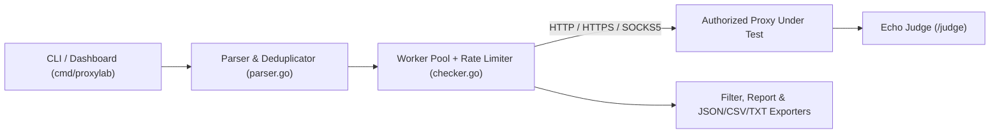

# ProxyLab

High-concurrency HTTP, HTTPS, and SOCKS5 proxy verification, anonymity analysis, and reporting toolkit written in Go.

## Purpose & Problem Statement

Managing and validating proxy pools manually or with single-threaded scripts does not scale, fails to distinguish transparent from anonymous or elite endpoints, and lacks structured reporting. ProxyLab provides a concurrent Go worker engine with token-bucket rate limiting, an authorized local echo judge for isolated testing, multi-format exporters, and an embedded web dashboard.

## Features

- **Multi-Protocol Probing**: HTTP, HTTPS, and SOCKS5 (`golang.org/x/net/proxy`) proxy verification with configurable timeouts and retry attempts.
- **Rate-Limited Concurrent Engine**: Bounded worker pool paired with `golang.org/x/time/rate` token-bucket RPS throttling.
- **Anonymity Classification**: Evaluates forwarded headers (`X-Forwarded-For`, `Via`, `Forwarded`, `X-Real-Ip`) returned by an authorized echo judge to classify proxies as `elite`, `anonymous`, or `transparent`.
- **Deduplication & Filtering**: Removes duplicate entries on ingest and filters results by status, protocol, anonymity, max latency, success rate, and country code.
- **Built-in Echo Judge (`proxylab judge`)**: Self-hosted echo endpoint for testing authorized proxy infrastructure safely.
- **Exporters & Web Dashboard**: Export to JSON, CSV, and TXT from CLI or inspect and export via `/api/results`, `/api/report`, and `/api/export`.

## Tech Stack

- **Language**: Go 1.24 (`net/http`, `sync`, `flag`)
- **Packages**: `golang.org/x/net/proxy`, `golang.org/x/time/rate`
- **Dashboard**: Embedded HTML/JS UI (`go:embed`)

## System Requirements

- Go 1.24 or newer

## Installation

```bash
git clone https://github.com/fully-ai/proxylab.git
cd proxylab
go build -o proxylab ./cmd/proxylab
```

## Configuration & CLI Flags

| Subcommand | Key Flags | Description |
| --- | --- | --- |
| `judge` | `-addr` (`127.0.0.1:8086`) | Run built-in authorized echo judge server |
| `check` | `-input`, `-judge`, `-concurrency`, `-rps`, `-timeout`, `-attempts`, `-alive-only`, `-format`, `-output` | Verify proxy list and write JSON/CSV/TXT output |
| `serve` | `-addr` (`127.0.0.1:8085`), `-judge` | Run web dashboard and JSON/export API |
| `version` | — | Print binary version |

## Running & Usage Examples

```bash
# 1. Start the built-in echo judge on an authorized host
./proxylab judge -addr 127.0.0.1:8086

# 2. Check a list of proxies (`protocol://host:port[,COUNTRY]`)
./proxylab check -input proxies.txt -judge http://127.0.0.1:8086 \
  -concurrency 32 -rps 50 -attempts 2 -alive-only -format csv -output alive.csv

# 3. Launch the web dashboard
./proxylab serve -addr 127.0.0.1:8085 -judge http://127.0.0.1:8086
```

## API Documentation

| Method & Path | Description |
| --- | --- |
| `GET /` | Embedded web dashboard |
| `GET /judge` | Built-in echo judge JSON endpoint (`remote_ip` and forwarded headers) |
| `GET /api/results` | Filterable results (`?alive=true&protocol=socks5&anonymity=elite&country=US`) |
| `GET /api/report` | Aggregate summary counts and average latency |
| `GET /api/export` | Export filtered results (`?format=json\|csv\|txt`) |
| `POST /api/check` | Submit proxy list text and optional `judge_url` for checking |

## Architecture



## File Structure

```
proxylab/
├── cmd/proxylab/main.go         # CLI subcommands (check, serve, judge, version)
├── internal/
│   ├── proxy/
│   │   ├── types.go             # ProxySpec, CheckResult, SummaryReport
│   │   ├── parser.go            # Line parser & deduplicator
│   │   ├── checker.go           # Concurrent HTTP/HTTPS/SOCKS5 prober & echo judge
│   │   ├── filter.go            # Result filtering & summary statistics
│   │   ├── export.go            # JSON, CSV, TXT writers
│   │   └── checker_test.go      # HTTP & local SOCKS5 server integration tests
│   └── dashboard/
│       ├── server.go            # Web dashboard HTTP handlers
│       ├── server_test.go       # Dashboard API & export tests
│       └── index.html           # Dashboard frontend
├── docs/architecture.md
└── Dockerfile
```

## Testing

```bash
go vet ./...
go test -v -race ./...
```

## Docker Deployment

```bash
docker build -t proxylab .
docker run --rm -p 8085:8085 proxylab serve -addr 0.0.0.0:8085
```

## Security Notes

- Use ProxyLab strictly against proxy infrastructure and echo endpoints you own or have explicit authorization to test.
- `/api/check` bounds request bodies via `http.MaxBytesReader` (1 MiB) and applies context timeouts.

## Known Limitations

- Country codes are read from optional `,COUNTRY` input suffixes rather than an offline MaxMind GeoIP database.
- SOCKS4/4a is not implemented; HTTP, HTTPS, and SOCKS5 are supported.

## Contributing

See [CONTRIBUTING.md](CONTRIBUTING.md) and [CODE_OF_CONDUCT.md](CODE_OF_CONDUCT.md).

## License

Apache License 2.0 — see [LICENSE](LICENSE).
